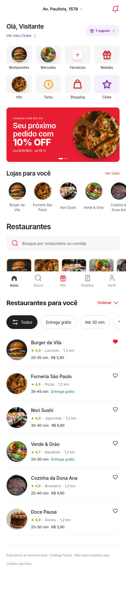

# iFood — reconstrução web com REA

Aplicação web independente, responsiva que pode ser publicada em qualquer hospedagem estática. A análise com REA/JADX e a pesquisa de referências orientaram a implementação. Viagens, catálogo, pedidos e pagamentos são demonstrações locais; não existe conexão com os serviços da empresa.

- Busca e categorias; favoritos; produtos com adicionais, quantidade e observação.
- Sacola, cupom BEMVINDO (10%, limite R$ 10), endereço e pagamento simulado.
- Pedido, acompanhamento, cancelamento, repetição e persistência local.
- Identidade visual em início, busca, Hits, favoritos, restaurante, produto, sacola, finalização, pedido e perfil.
- Wordmark vetorial, fontes iFood RC Textos/Títulos e artes de categorias do CDN oficial.
- Confete ao adicionar à sacola; confirmação animada do aceite, panela com vapor no preparo entregador ilustrado ao sair para entrega e celebração de pedido entregue.
- Cinco abas e grade de serviços; abertura original de 3 s; loader, cupom e favoritos originais.

## Executar

```bash
npm start
```

Abra http://localhost:3000. Requer Python 3 para o servidor. Não há dependências npm de execução ou etapa de compilação: `dist/` contém o código-fonte editável e os arquivos servidos. A configuração em `dist/config.js` limita a experiência a iFood. Os dois projetos usam o mesmo motor de interface e modelos; os recursos de mídia específicos da outra aplicação não são incluídos.

## Verificar

```bash
npm run check
npm test
python3 -m pip install -r requirements-test.txt
python3 -m playwright install chromium
# Com npm start rodando em outro terminal:
TEST_OUTPUT=verification-local npm run test:browser
```

`BASE_URL` permite testar outra porta. `CHROMIUM_PATH` seleciona um navegador instalado. Os testes cobrem os fluxos principais, telas de 360/390/1440 px, persistência, erros JavaScript, movimento reduzido e integridade SHA-256 das animações e dos recursos visuais. `verification/` guarda os resultados e imagens desta entrega. `npm run test:visual` produz a auditoria dos estados preenchidos. Em ambientes cujo Chromium não herda o certificado confiável do proxy, `USE_SYSTEM_CA_PROXY=1` encaminha apenas os tiles públicos pelo cliente Python, com verificação TLS habilitada; não altera o aplicativo.

## Movimento e fidelidade

Acesse **Perfil/Conta → Animações originais** para revisar os recursos recuperados. O player mantém os arquivos, frames e velocidade 1×. A preferência de movimento reduzido é respeitada. O manifesto em `dist/assets/motion/manifest.json` registra origem, hash, FPS e duração.

A identidade visual foi aplicada a todas as telas implementadas e seus diálogos. As telas completas dos APKs truncados não puderam ser executadas. Campanhas, produtos, ícones não recuperados e transições entre telas continuam sendo adaptações. Não há validação de identidade pixel a pixel de todas as versões. Consulte [a cobertura visual v3](docs/identity-v3.md), [a matriz de fidelidade](docs/fidelity.md), [a pesquisa de iFood](references/ifood/research.md) e [os créditos](NOTICE.md).



## Arquivos

- `dist/`: interface, modelos, configurações, imagens, fontes e players locais.
- `tests/`: testes de modelos, integridade de animações e aceitação no navegador.
- `references/ifood/`: fontes pesquisadas, inventário de movimento e capturas públicas de referência.
- `evidence/`: evidências estáticas da análise REA. Os APKs originais permanecem fora deste repositório.
- `docs/`: decisões de implementação e limites verificáveis.
- `verification/`: resultados e capturas da aplicação entregue.

REA original: https://github.com/morluto/rea, commit `69324b0f86cc9a209905831b12a18d43afe3657d`; CLI 6.5.0, JADX 0.7.1. O REA foi uma ferramenta de análise; não é uma dependência necessária para abrir o site.

## Novos efeitos de pedido e sacola

Veja [a pesquisa pública e a implementação](docs/ifood-motion-v4.md). Execute `npm run test:effects` com o servidor ativo para validar confete, aceite, preparo, entregador, pedido entregue e movimento reduzido. As cenas de aceite/preparo/entrega/conclusão são adaptações web; o confete reaproveita camadas originais de campanha.
